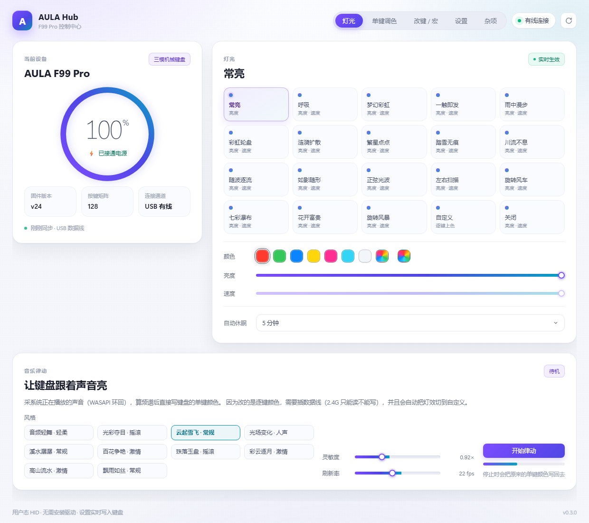
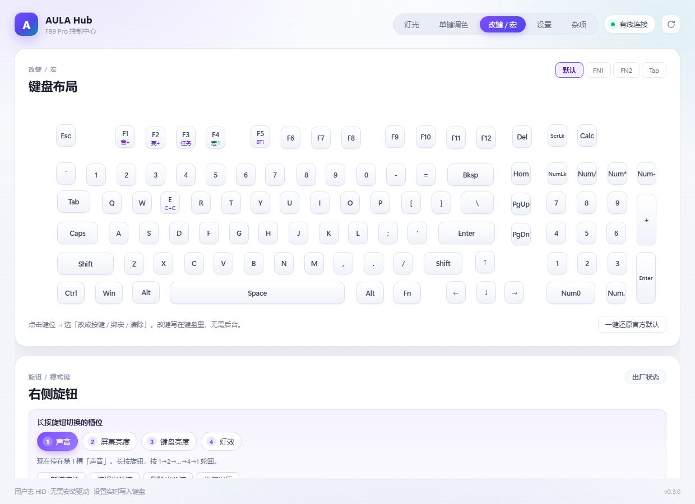
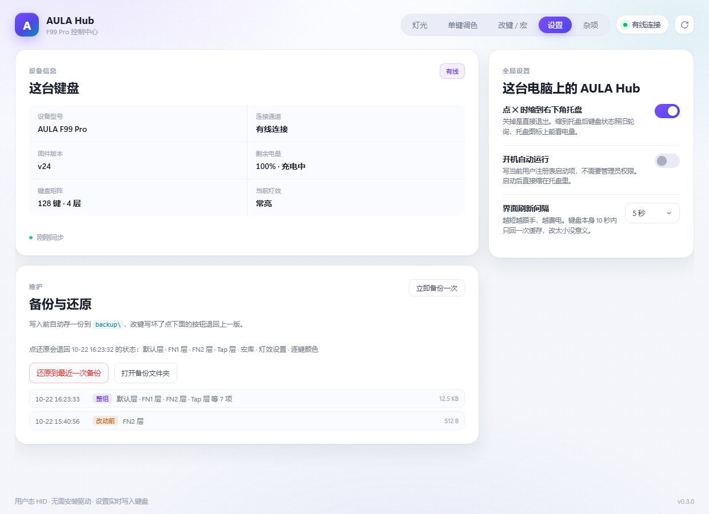

# AULA Hub

[](LICENSE)
[](#安装)
[](requirements.txt)
[](docs/SELF-CHECK.md)

<!--
一句话摘要（给搜索引擎和人看的，不必逐字读）：
狼蛛 AULA F99 Pro 键盘驱动替代品。官方驱动看不到电量？这个能看。
开源、免安装、不需要 Python，Windows 10/11 双击即用。
功能覆盖：键盘灯效（20 种）、逐键 RGB（126 灯位单独调色）、音乐律动（10 种风格）、
改键（4 层：默认 / FN1 / FN2 / Tap）、宏录制（写进键盘本体 10 KB 宏库）、
旋钮（15 种可绑定动作、长按切自定义槽位）、电量显示、2.4G 无线读取。
完全离线、不装内核驱动、不碰固件。
同款型号：F99 Pro / F99Pro / F99-PRO / AULA F99 / 狼蛛F99 / 狼蛛 F99 Pro / AULA-F99Pro。
硬件 ID：258A:010C（有线）、3554:FA09（2.4G 接收器）。
-->

> 🌐 [English](README.en.md) · 中文

**一个现代化、开源的狼蛛 AULA F99 Pro 键盘控制中心 —— 替代那个 2019 年风格、还不显示电量的官方驱动。**

> **直接下载**：[AULA-Hub-portable.zip](https://github.com/xx12ek/aula-f99-pro-hub/releases/latest) · 免安装、不需要 Python、不需要管理员权限

原厂驱动的问题：界面停留在 Windows 7 年代、三个型号配置里 `ShowPower=0` 导致**永远看不到电量**、改键要做一堆反人类的点击、没有命令行、没有 Linux 支持。

这个项目用**纯用户态 HID**（不装驱动、不改系统、不碰固件）重写了一遍，把原厂藏起来的能力全部挖出来并补齐。

---

## 界面

<table>
<tr>
<td width="50%"><br><b>灯光</b> — 20 种灯效、亮度/速度无极拖动、逐键调色、10 种音乐律动</td>
<td width="50%"><br><b>改键 / 宏</b> — 4 层、8 类功能、每颗键显示真实中文功能名</td>
</tr>
<tr>
<td><br><b>设置</b> — 设备信息、托盘行为、开机自启、备份还原</td>
<td><br><b>杂项</b> — 配置导入导出、去抖诊断、原始配置页、恢复出厂</td>
</tr>
</table>

> 截图是 `?demo=1` 的离线演示模式（不需要接键盘也能看界面）。

## 它现在能做什么

### 灯光
- **20 种灯效**（含「关闭」），与键盘固件一一对应
- 亮度（0–9 档）、速度（0–4 档）**无极拖动 + 松手缓动吸附**，改完立即生效
- **逐键颜色**：126 个灯位单独调色，内置色盘（HSV 圆环 + 明度条）
- **10 种音乐律动**：走 WASAPI 环回采集系统正在播放的声音，FFT 后按节奏刷灯
- 颜色组与灯效槽位按原厂 `LedOptN` 表精确映射（不是猜的）

### 改键 / 宏
- **4 层**：默认按键层 / FN1 / FN2 / Tap
- **8 个功能分类**：键盘、鼠标、多媒体、常用命令、组合键、修饰键、键盘内建、软件功能
- 每颗键直接显示**真实中文功能名**（不再是一排「特殊」）
- 宏录制：按键序列 + 延时，存进键盘本体的 10 KB 宏库
- 每一个写操作都**读回校验**，写不进去会明确报错而不是假装成功

### 旋钮
- **15 种可绑定动作**（系统音量 / 屏幕亮度 / 键盘背光 / 灯效切换 / 音乐律动…）
- **可增删改的槽位**：长按旋钮在自定义槽位之间轮回切换，槽位内容和数量都由你定
- 音量走**系统原生**通道（放行真键 → Windows 自己画那条胶囊提示条）
- 其余动作走**自绘 OSD**，尺寸/圆角/图标/强调色逐像素对齐 Windows 11 实测值

### 其它
- **电量**：数字 + 环形进度 + 充电状态（原厂藏了这个功能）
- **2.4G 无线支持**：读取全部状态、改灯效/亮度/速度/休眠；写改键与逐键颜色需要插线（协议层限制，不是偷懒）
- **固件模式守护**：长按旋钮会让键盘进入固件自己的模式（旋钮只调背光、不再发任何按键），后台自动把它拉回来
- 托盘常驻、关窗不退出、开机自启（可选）、电量图标
- 备份 / 还原：每次写设备前自动存一份快照，一键回到上一版

---

## 安装

### 方式一：直接下载（推荐，普通用户）

到 [Releases](https://github.com/xx12ek/aula-f99-pro-hub/releases) 下载 `AULA-Hub-portable.zip`，解压到任意目录，双击 `AULA-Hub.exe`。

- 免安装、不需要管理员权限、不需要装 Python
- 只支持 **Windows 10 / 11 x64**

### 方式二：从源码跑（开发者）

```bash
git clone https://github.com/xx12ek/aula-f99-pro-hub.git
cd aula-hub
pip install -r requirements.txt
python app.py
```

需要 Python 3.10+ 和 Edge WebView2（Win11 自带，Win10 可能要装一次）。

---

## 支持哪些键盘

目前**只针对 AULA F99 Pro** 验证过。判断你的键盘能不能用：

| VID | PID | 型号 |
|---|---|---|
| `0x258A` | `0x010C` | 有线 |
| `0x3554` | `0xFA09` | 2.4G 接收器 |

在 PowerShell 里跑这句能看到你的设备：

```powershell
Get-PnpDevice -Class HIDClass | Where-Object { $_.InstanceId -match "258A|3554" } | Select-Object FriendlyName, InstanceId
```

AULA 的其他型号（F75 / F87 / F99 非 Pro）大概率共用同一套协议，但**没有实测数据**，能用或不能用都欢迎开 issue 告诉我。

---

## 已知做不到的事

我宁愿写清楚，也不想让你点半天才发现：

| 做不到 | 原因 |
|---|---|
| 2.4G 下写改键 / 写逐键颜色 / 写宏 | 固件的无线通道只开放了读命令。实测 24 + 18 组命令组合全部无效 |
| 2.4G 下改旋钮槽位 | 同上，读不到配置页 |
| 让软件唤出 Windows 原生的亮度条 | 试过 WASAPI / SendInput / keybd_event / 扫描码 / WM_APPCOMMAND / WMI / Dxva2，**全部不弹**。只有真实硬件按键才会触发 |
| 从软件升级固件 | 原厂 V3 工具是烧录器，本体不含 `.hex`。刷坏就变砖 |
| 关掉「长按旋钮切固件模式」 | 那是固件行为，用户态关不掉。只能让它切、然后立刻接管回来 |

---

## 这是怎么逆向出来的

整个项目建立在**对原厂驱动 `OemDrv.exe` 与键盘固件协议的逆向**之上。核心发现（完整记录见 [`docs/PROTOCOL.md`](docs/PROTOCOL.md)）：

- **有线通道**：HID feature report，report id `6`，520 字节（8 字节头 + 512 数据）
- **2.4G 通道**：20 字节中断包，report id `0x13`，末字节是 `sum(all)&0xFF` 校验
- **配置页**：128 字节，尾标记 `5A A5`，灯效表从 `0x3A` 起每槽 2 字节
- **矩阵记录**：每键 4 字节，`b0` 是功能类别（普通键/命令/Consumer/宏/鼠标/固件内建…）
- **逐键颜色**：不是 RGBRGB 交错，而是 **R×126 + G×126 + B×126 三个平面**传输 —— 搞错会让整块颜色乱套

**没有任何固件被修改。** 所有操作都是驱动本来就支持、只是没在界面上给你的命令。

---

## 项目结构

```
aula-f99-pro-hub/
├── app.py              主程序 + pywebview 窗口 + JS↔Python 桥
├── core/
│   ├── aula.py         HID 协议层（有线 / 2.4G / 配置页 / 矩阵 / RGB / 宏）
│   ├── knob_router.py  旋钮接管（低级键盘钩子 + 槽位 + OSD）
│   ├── knob_mode.py    长按旋钮识别（配置页指纹）
│   ├── mode_guard.py   固件模式自动拉回
│   ├── osd.py          自绘 OSD（纯 Win32 layered window）
│   ├── sysvol.py       WASAPI 音量 + WMI 屏幕亮度
│   ├── music.py        音乐律动引擎（WASAPI loopback + FFT）
│   ├── macro.py        宏编码/解码
│   ├── misc.py         导入导出 / 恢复出厂 / 原始配置页
│   ├── settings.py     应用设置
│   ├── tray.py         系统托盘
│   └── chrome.py       Windows 深色标题栏
├── ui/                 前端（原生 HTML/CSS/JS，无框架无构建）
├── tools/selfcheck.py  25 项功能自检脚本
└── docs/               协议文档、自检报告
```

---

## 自检

想确认在你机器上一切正常，跑：

```bash
python tools/selfcheck.py
```

会逐项验证 25 个能力并打印 PASS/FAIL，所有写操作写完都会还原。最后一次结果见 [`docs/SELF-CHECK.md`](docs/SELF-CHECK.md)。

---

## 安全性

- **不装内核驱动**、不需要管理员权限、不写系统目录
- **不改固件**，所有命令都在原厂驱动已有的能力范围内
- 唯一的全局钩子是 `WH_KEYBOARD_LL`，**只截三个旋钮键**（音量+/-/静音）和 `F13`–`F20`，其它按键一律原样放行
- 网络：**完全离线**，不联网、不上传、不检查更新

源码全部公开，欢迎审计。

---

## 贡献

如果你有 AULA 的其他型号并且愿意帮忙测试，非常欢迎：

1. 用 `tools/selfcheck.py` 跑一遍，把输出贴到 issue
2. 或者直接开 issue 告诉我型号 + VID/PID + 哪些功能能用

协议文档（`docs/PROTOCOL.md`）里标了哪些结论是**实测确认**、哪些是**推测未验证**，请以实测为准。

---

### 驱动怎么安装？

不用安装。下载 `AULA-Hub-portable.zip`，解压到任意文件夹（不要放在桌面以外的系统目录），
双击 `AULA-Hub.exe`。第一次启动 Windows 可能弹一次「已保护你的电脑」，点"更多信息 → 仍要运行"。

想让它开机自启：设置页 → 开机自动运行。想到右下角常驻：设置页 → 关闭时缩小到托盘。

### 灯效怎么调？

打开软件第一页「灯光」。左边 20 个灯效卡，点一下就生效（不用点保存）。
下滑是亮度条和速度条，拖动即可，松手自动吸附到最近的档位。

想把整块键盘改成一个颜色：选「自定义」灯效 → 点颜色圆片 → 用色盘挑色。

### 单颗键怎么单独变色？

第二页「调色」。左边是键盘俯视图，点任意一颗键，右边选颜色。
126 个灯位都可以单独设。

注意：必须先在灯光页切到「自定义」灯效，单键颜色才会显示（这是固件要求，不是软件限制）。

### 怎么改键？怎么设置宏？

第三页「改键」。

- **改键**：点键盘图上任意一颗键 → 弹出功能面板 → 8 个分类随便选。选完立即写入键盘。
- **宏**：面板里选「宏」→ 新建 → 录制你的按键序列 → 保存。宏存在键盘本体里（10 KB 空间），
  不是存在电脑里，所以换电脑也能用。

有 4 层可以分别设置：默认按键层 / FN1 层 / FN2 层 / Tap 层。左上角切换。

### 旋钮怎么用？

第四页「旋钮」。

- 转动方向可以分别绑 15 种动作（音量、屏幕亮度、键盘背光、切灯效、开关音乐律动……）
- **长按旋钮** 会在这几个槽位之间轮回切换 —— 槽位可以自己增删改名字和绑定
- 按下旋钮也能单独绑

如果你长按旋钮后键盘变得"不听话"（旋钮只调背光、电脑收不到按键），那是进了键盘固件自己的模式。
本软件有守护，几秒内会自动拉回来。

### 电量在哪看？

左上角那个圆环就是。插着线显示"已接通电源"，无线时显示百分比和"电池供电"。

右下角托盘图标也显示电量，鼠标悬停就能看到。

### 怎么恢复出厂设置？

「杂项」页最下面 → 恢复出厂。会清掉所有改键、宏、灯效设置。

**建议先点上面的「立即备份」和「导出配置」**，出问题能一键还原。

### 键盘多久休眠？能改吗？

能。「杂项」页 → 自动休眠，9 档可选（1 分钟到 20 分钟）。

休眠后随便按一个键就唤醒，软件几秒内会自动重连。

### 为什么插着数据线，2.4G 接收器就没反应？

键盘固件在同一时间只走一条通道。插线时优先有线，拔线后几秒自动切 2.4G。

想切 2.4G：拔掉数据线即可。想切有线：插上数据线。

---

---

## 搜索关键词 / Keywords

<sub>这一节是给人搜的，不是给读的 —— 如果你是从搜索引擎或 GitHub 搜索进来的，命中的应该是下面某一行。</sub>

**中文**：狼蛛 F99 Pro 驱动 · 狼蛛F99Pro驱动 · 狼蛛键盘驱动 · 狼蛛驱动下载 · AULA驱动 ·
AULA F99 Pro 驱动 · 狼蛛 F99 Pro 软件 · 狼蛛键盘电量 · 键盘电量显示 · 狼蛛键盘灯光软件 ·
狼蛛改键软件 · 狼蛛宏设置 · 狼蛛旋钮 · 狼蛛键盘说明书 · 狼蛛键盘固件 · F99 Pro 驱动替代 ·
官方驱动太丑 · 官方驱动没有电量 · 国产键盘驱动 · 磁轴键盘驱动（本型号是机械轴，不支持） ·
机械键盘改键工具 · 键盘逐键RGB · 键盘音乐律动 · 键盘灯效软件 · 免安装键盘驱动 ·
开源键盘驱动 · 键盘驱动逆向

**English**: AULA F99 Pro driver · AULA keyboard software · AULA driver download ·
AULA F99 Pro software · AULA keyboard battery · AULA lighting software ·
AULA remapping · AULA macro software · AULA knob · AULA firmware ·
replace AULA driver · AULA driver alternative · Chinese keyboard driver ·
HID keyboard tool · per-key RGB keyboard · keyboard music visualizer ·
open source keyboard driver · keyboard driver reverse engineering ·
258A:010C · 3554:FA09

**型号写法**（同款键盘的各处叫法）：F99 Pro · F99Pro · F99-PRO · AULA F99 · 狼蛛F99 ·
狼蛛 F99 Pro · 狼蛛F99Pro · 狼蛛 F99PRO · AULA-F99Pro

---

## 同款键盘常见问题

<sub>装不上、调不动、看不懂？先看这里。每一条都是实际被问过的。</sub>

### 官方驱动看不到电量，是键盘不支持吗？

不是。原厂 `KB.ini` 里三个型号配置都写着 `ShowPower=0`，等于**官方主动把这个功能关掉了**。
键盘固件本身有电量命令（有线 `0x87`、2.4G `0x4A`），本软件直接读它，所以能显示。

### 官方驱动太老了，还在用 Windows 7 的风格

原厂最后一次更新是 2024 年，界面是 MFC 时代的产物。本软件用 WebView2 重写了界面，深色/浅色跟随系统。

### 我这个是 F99 还是 F99 Pro？能用吗？

设备管理器里看硬件 ID：
- `USB\VID_258A&PID_010C` → F99 Pro 有线，**确定支持**
- `USB\VID_3554&PID_FA09` → 2.4G 接收器，**确定支持**
- 其他 VID/PID → 大概率不支持，但你可以跑 `tools/selfcheck.py` 看看，然后把结果贴到 issue

一行命令自查：

```powershell
Get-PnpDevice -Class HIDClass | Where-Object { $_.InstanceId -match "258A|3554" } |
  Select-Object FriendlyName, InstanceId
```

### 会不会把键盘刷坏？

不会。本软件**完全不碰固件**，只发标准 HID 读写命令，和不装任何软件相比风险没有增加。
唯一会写设备的地方是改灯效/改键/写颜色，这些都能用「导出配置」先备份、再一键还原。

### 为什么 2.4G 下有些功能是灰的？

固件在无线通道上只开放了**读**命令。写改键、写逐键颜色、写宏在 2.4G 下发出去设备不响应
（我们试了 24 + 18 组命令组合，全部无效）。插上数据线就全功能可用。

### 能刷固件吗？

不能。原厂的 V3 升级工具（`V3-F99Pro_20240508.exe`）只是一个**烧录器**，本身不含固件镜像
——它启动后让你选一个 `.hex` 文件。没有那个文件，谁也没法刷。

### 长按旋钮为什么会让键盘进一个奇怪的模式？

那是**键盘固件自己的行为**，用户态关不掉。表现是旋钮开始直接调键盘背光、并且不再给电脑发按键。
本软件有一个「固件模式守护」：检测到就会立刻把状态拉回来，所以你会看到指示灯闪一下然后恢复正常。

---
## 许可

MIT。字体与图标均为自制，无第三方素材。
